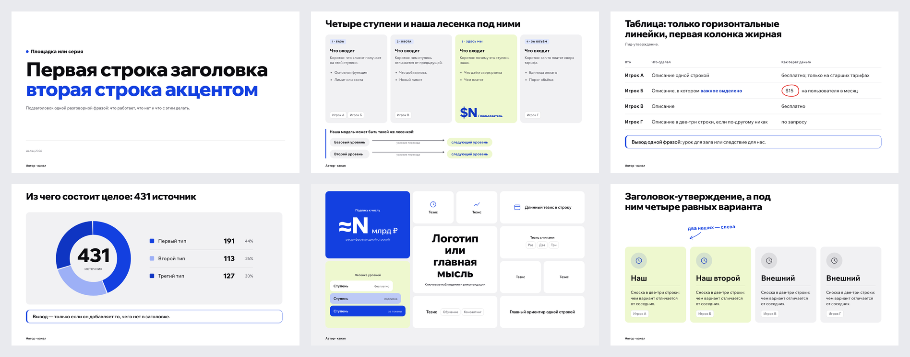
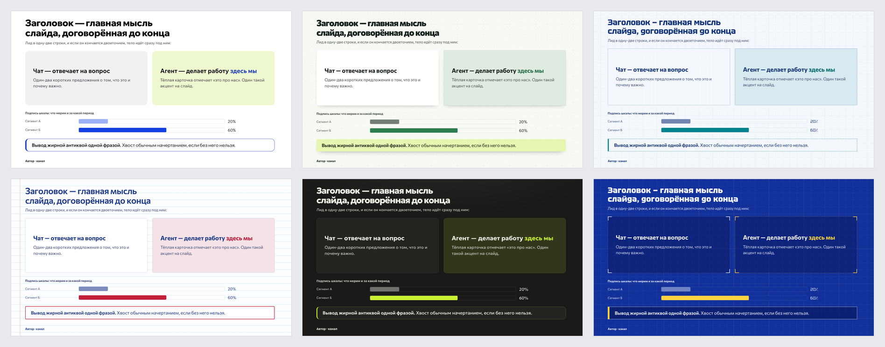

<div align="center">

# html-deck — HTML-презентации для Claude Code и Codex

**Скилл для создания и редактирования HTML-презентаций: агент готовит план, собирает слайды и проверяет текст и вёрстку.**

Один HTML-файл, сцена 1280×720, шесть тем со встроенными шрифтами.
Готовая дека открывается в браузере без интернета; PDF получается через печать.

[](#установка)
[](#установка)
[](https://github.com/tonyprots/html-deck-skill/releases/latest)
[](LICENSE)



<sub><a href="#быстрый-старт">Быстрый старт</a> · <a href="#установка">Другие способы установки</a> · <a href="#использование">Скрипты</a> · <a href="#темы">Темы</a> · <a href="#ограничения">Ограничения</a> · <a href="#english-summary">English summary</a></sub>

</div>

## Быстрый старт

Установите скилл из папки проекта через [skills CLI](https://github.com/vercel-labs/skills)
и выберите своего агента. Для этой команды нужны Node.js и npm; для скриптов скилла — Python 3.9+.

```bash
npx skills add tonyprots/html-deck-skill --skill html-deck
```

Затем попросите агента:

> Используй html-deck. Собери HTML-презентацию для команды по итогам квартала,
> на 10 минут. Сначала предложи план; после согласования сохрани деку в index.html.

Агент уточнит аудиторию и исходные материалы, предложит план, затем соберёт деку.
Откройте `index.html` в браузере. Стрелки и пробел листают слайды, F включает полный экран.
Для правки готовой презентации: «Используй html-deck, причеши эту деку» и путь к файлу.

Результат — HTML-презентация. PPTX скилл не создаёт. Текстовые правила рассчитаны на русский язык.

## Как скилл собирает презентацию

- **Заголовок — отгадка.** Слайд либо доказывает утверждение
  из заголовка, либо целиком отвечает на прямой вопрос («Как выглядит
  пайплайн»). Заголовки, прочитанные подряд, складываются в рассказ.
  Подковырки, лозунги и тезисы раньше аргумента агент убирает сам.
- **Правила из настоящих правок.** 41 пара «было → стало» и таблицы того,
  что снималось и почему, словами докладчика: «вывод убрать», «серые
  строчки чаще всего мешают», «пример выдуманный — замени реальным».
  На новой деке агент ищет такие же типы ошибок, дословные совпадения
  ему не нужны.
- **Сначала план текстом, потом вёрстка.** Агент спрашивает аудиторию,
  длительность и обязательные темы, затем пишет план по слайдам со всем
  текстом, примерами и источниками цифр. Верстать он начинает только после
  вашего «да». Так большие волны правок приходятся на план, пока
  переделывать дёшево.
- **Фиксированная сцена.** Слайд 1280×720 масштабируется целиком,
  сохраняя пропорции блоков. Перед показом на другом устройстве нужно проверить шрифты и переносы.
- **Аудит вместо «мне кажется».** `audit-browser.js` проходит все слайды и
  ловит зазоры меньше 8 px, вылеты, контраст ниже нормы (и на
  полупрозрачных фонах тоже), кегль меньше 12 px, тёмные плашки в светлой деке,
  наложение кнопок на контент и забытую фавиконку из шаблона.
  `deck_text.py --lint` считает слова на слайд, ловит качели «не X, а Y» и
  выписывает латиницу, которую залу придётся расшифровывать.
- **Два режима.** «Собрать с нуля» из шаблона и «причесать» готовую деку.
  Во втором режиме агент делит находки на то, что правит сам, что показывает диффом и что
  оставляет вам в разделе «На решение автора». Продиктованное вами дословно
  он не переписывает.
- **Одна дека — один файл.** Шрифты темы вшиваются в HTML. Шаблон с темой
  работает без внешних загрузок; добавленные видео и другие внешние материалы нужно проверять отдельно.
- **Пульт с телефона.** `add-clicker.py` подшивает в деку блок, который
  листает слайды с телефона, показывает оглавление и гасит экран. Разметку
  деки блок не трогает. Нужен свой ретранслятор, см. «Ограничения».
- **Тема с характером.** «Клуб» вырос из настоящего доклада, где шрифты,
  маркер и пометки выбирались в несколько раундов сравнения: заголовки Wix
  Madefor Display, подписи капителью Geologica, мазок кисти лаймом под
  главным словом, красная обводка от руки вокруг цифры.

## Установка

Нужен агент с поддержкой `SKILL.md`. Python-скрипты используют стандартную библиотеку;
для проверки вёрстки агенту нужен доступ к браузеру либо помощь с запуском аудита в DevTools.

**Claude Code**, через маркетплейс плагинов:

```text
/plugin marketplace add tonyprots/html-deck-skill
/plugin install html-deck@tonyprots
```

**Claude Code и Codex:** команда skills CLI приведена в [быстром старте](#быстрый-старт).
Чтобы сначала посмотреть доступные скиллы без установки:

```bash
npx skills add tonyprots/html-deck-skill --list
```

**Вручную**, клоном и симлинком:

```bash
git clone https://github.com/tonyprots/html-deck-skill
mkdir -p ~/.claude/skills
ln -s "$PWD/html-deck-skill/skills/html-deck" ~/.claude/skills/html-deck
```

Для Codex создайте каталог `~/.agents/skills/` и поместите ссылку туда.
Если `html-deck` уже установлен, сначала проверьте существующую папку; эти команды её не заменяют.

## Использование

Скрипты работают и без агента. После клонирования выполните команды **из корня репозитория**:

```bash
cd html-deck-skill

# создать локальный пример и встроить тему
cp skills/html-deck/assets/template.html example.html
python3 skills/html-deck/scripts/apply-theme.py example.html skills/html-deck/themes/club

# проверить текст примера
python3 skills/html-deck/scripts/deck_text.py example.html --lint
python3 skills/html-deck/scripts/deck_text.py example.html --lint --genre analytic

# необязательно: добавить блок пульта и запрет индексации
python3 skills/html-deck/scripts/add-clicker.py example.html --noindex -o public/deck.html
```

Откройте `example.html` в браузере. Пульту нужен отдельный ретранслятор, см. [ограничения](#ограничения).
Код выхода 1 у текстового линтера означает найденные замечания: их нужно разобрать по контексту.

Аудит вёрстки лежит в [scripts/audit-browser.js](skills/html-deck/scripts/audit-browser.js). Его выполняют на открытой
деке при окне 1280×720: агент делает это через доступный браузерный инструмент, а
вручную можно вставить содержимое файла в консоль DevTools. Скрипт возвращает JSON со
списком слайдов и проблем.

Горячие клавиши деки: стрелки и пробел листают, F (или А в русской
раскладке) включает полный экран, `#s=N` в адресе открывает слайд N (счёт с нуля),
`?export=1` прячет кнопки и анимацию. Нужен PDF — печать из браузера с
`?export=1`, по слайду на страницу.

## Темы



| Тема | Характер | Когда брать |
|---|---|---|
| `club` · Клуб | белая сцена, синий акцент, мазок кисти лаймом под главным словом, обводка от руки | по умолчанию: доклад, митап, внешнее выступление |
| `notebook` · Тетрадь | бумага в точку, зелёные чернила, блоки — вклеенные листы, вывод — лаймовый стикер | исследование, аналитика, стратегия |
| `draft` · Калька | чертёжная сетка, заголовки капсом, блоки — контуры, вывод — пунктирная рамка | архитектура, инженерный доклад |
| `school` · Школа | тетрадь в линейку с красным полем, вывод обведён красной ручкой | обучение, онбординг, лекция |
| `graphite` · Графит | тёмная: тёплый графит, лаймовый акцент | финансы, метрики, тёмный зал |
| `blueprint` · Синька | тёмная: чертёжный синий, жёлтые пометки | инженерия в тёмном зале |
| без темы | белый, глубокий зелёный акцент, антиква New York | тема не нужна или дека уйдёт в чужой шаблон |

Тема задаёт цвета, шрифты и форму блоков: у карточек, вывода
слайда и плиток бенто в каждой теме своя заливка, рамка, тень и скругление.
Шрифты распространяются по SIL OFL 1.1 и вшиваются в деку. Тёмные темы агент берёт только по
прямой просьбе.

Контраст каждой темы пересчитан: текст от 7:1, подписи и текст акцентом от
4,5:1, крупные числа и линии от 3:1. Свою корпоративную тему или тему
площадки, где вы выступаете, можно завести одной папкой с `theme.css`,
`logo.svg` и `THEME.md` (см. [создание темы](skills/html-deck/themes/README.md), за образец удобно взять `club`).

## Что внутри

Файлы скилла находятся в [`skills/html-deck/`](skills/html-deck/). Пути в таблице указаны относительно этой папки.

| Файл | Зачем |
|---|---|
| `SKILL.md` | 13 правил, два режима работы, приём правок |
| `assets/template.html` | каркас: сцена, токены, 15 типовых слайдов (обложка, перебивка, карточки в две колонки, карточки в три колонки, четыре карточки с лесенкой, матрица, таблица, таймлайн, квадраты, круговая, «Что забрать», бенто итогов, «Кто говорит», «Что сделать в первую очередь», «Спасибо») |
| `references/text-rules.md` | заголовок, лид, вывод, что вычёркивать, словарь, форматы чисел, 41 пара «было → стало» |
| `references/repeat-offenders.md` | что агент делал не так по нескольку раз; с этого начинается режим «причесать» |
| `references/layout-rules.md` | сцена, зазоры, карточки, цвет и контраст, характер темы, тема площадки, типографика |
| `references/components.md` | какой компонент под какое содержание |
| `references/process.md` | разбор правок, версии, порядок вычитки, проверка в браузере |
| `scripts/` | аудит вёрстки, линтер текста, наложение темы, пульт |
| `themes/` | шесть тем, шрифты к ним (SIL OFL 1.1) и как завести свою |

## Ограничения

- **Русский язык.** Правила текста, словарь, линтер и примеры написаны для
  русскоязычных дек. Вёрстка, темы и аудит от языка не зависят.
- **Антиква New York есть только на macOS.** На Windows и Linux дека без
  темы откатывается на Georgia с другой шириной, поэтому перед показом с чужого
  ноутбука проверьте переносы заголовков или возьмите любую тему: её шрифты
  вшиты в деку.
- **Пульту нужен ретранслятор.** Дека и телефон обмениваются командами
  через небольшой HTTP-сервис, который хранит последнюю команду. Ни его, ни
  страницы для телефона в скилле нет; протокол описан в шапке
  `assets/clicker.js`. Без пульта дека работает как обычно.
- **Конвейер вычитки опирается на соседние скиллы:** `anti-slop`,
  `humanizer-ru`, `editorial`, `design-auditor`. Если их нет, агент проходит
  эти шаги по правилам самого html-deck и пишет об этом в отчёте.
- **PPTX скилл не делает.** Результат — HTML. Если нужен редактируемый
  PPTX на корпоративном шаблоне, это отдельный инструмент.

## Лицензия

MIT для кода, шаблона и текстов скилла — см. [LICENSE](LICENSE). Шрифты в [`themes/_fonts/`](skills/html-deck/themes/_fonts/)
распространяются по SIL Open Font License 1.1, тексты лицензий лежат рядом.

---

## English summary

`html-deck` is a Claude Code / Codex skill that teaches a coding agent to
build presentation decks as single-file HTML: a fixed 1280×720 stage that
scales as a whole, one idea per slide, headlines that state the point, and
no AI-slop styling. The rules come from hundreds of real edits a presenter
made on six real decks (41 before → after pairs, tables of what was
cut and why). The agent interviews you, writes the full slide-by-slide plan
as text for approval, and only then builds from the template. It can also
clean up an existing deck, sorting findings into fixes it makes, rewrites it
shows as a diff, and decisions it leaves to you. It ships with a browser
layout audit (gaps under 8 px, overflow, WCAG contrast over translucent
fills, dark fills in a light deck, font size floor), a text linter (words
per slide, "not X but Y" swings, Latin terms), six themes with embedded OFL
fonts, each with its own card, callout and bento styling (the default "Club"
has a lime brush-stroke marker and a hand-drawn ring; two are dark), and a phone remote (bring your own relay). Output is HTML
only; print to PDF from the browser. The text rules are written for Russian-language decks; layout,
themes and audit are language-agnostic. Install with
`/plugin marketplace add tonyprots/html-deck-skill` or
`npx skills add tonyprots/html-deck-skill --skill html-deck`. MIT license, by
[Anton Protsenko](https://tonyprots.ru).
